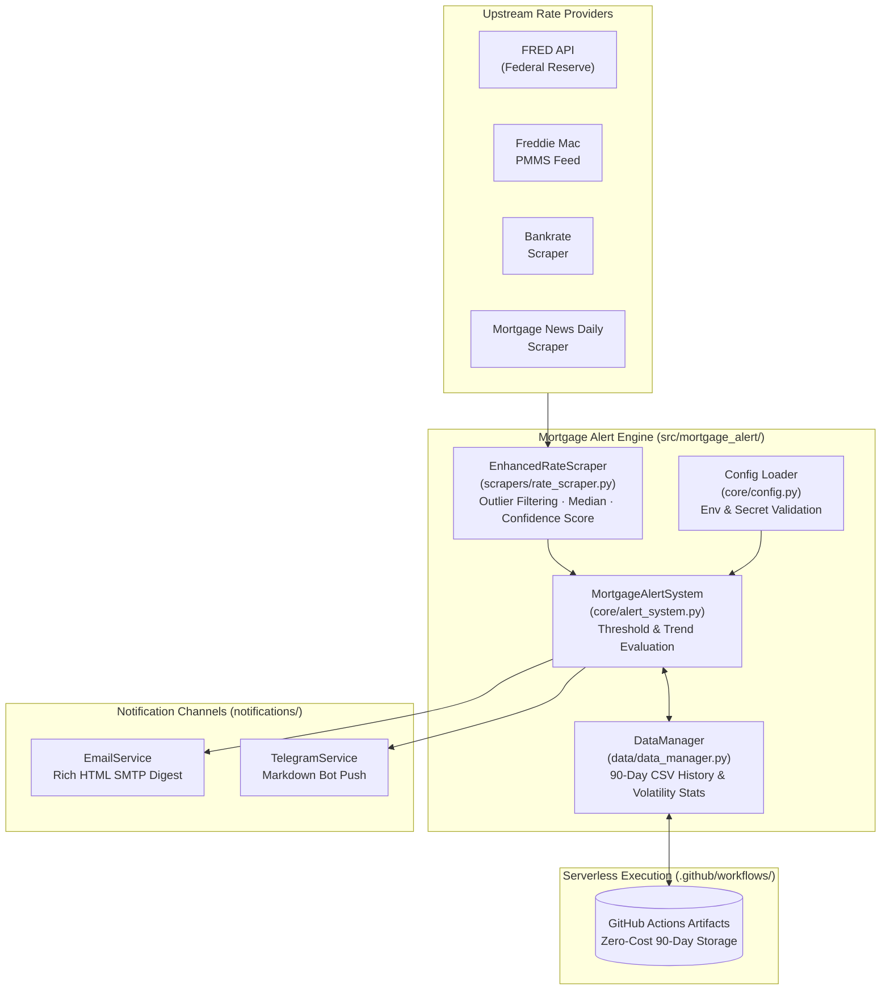

# Enhanced Mortgage Rate Alert System


A Python-based refinance mortgage rate monitoring and alerting platform. It aggregates 30-year fixed mortgage rates across multiple authoritative financial sources (FRED, Freddie Mac PMMS, Bankrate, and Mortgage News Daily), filters outliers using median aggregation and confidence scoring, persists 90-day historical trends via GitHub Actions Artifacts at zero infrastructure cost, and dispatches alerts via **Email (HTML)** or **Telegram**.

---

## 🎯 Use Case & Problem Statement

Homeowners looking to refinance must track daily interest rate fluctuations across multiple lenders and macroeconomic feeds. Single-source scrapers are brittle when websites change DOM selectors, and hosting a 24/7 cloud database/cron server just to track daily mortgage rates adds unnecessary monthly cost.

**This project solves both challenges:**
- **Multi-Source Consensus & Outlier Rejection:** Queries official Federal Reserve (FRED) APIs alongside industry rate feeds, computing the median rate and assigning a confidence score (`high`, `medium`, `low`) based on cross-source variance.
- **Zero-Cost Serverless Persistence:** Runs on a scheduled GitHub Actions cron workflow (`enhanced-rate-alert.yml`) that downloads prior CSV history from GitHub Artifacts, appends the day's aggregated observation, evaluates threshold & trend rules, and re-uploads the updated artifact.
- **Multi-Channel Alerting:** Sends actionable HTML email digests or instant Telegram bot notifications whenever rates drop below your configured `TARGET_RATE`.

---

## 🏗️ System Architecture



---

## 📁 Project Structure

```text
mortgage_alert/
├── .github/workflows/
│   ├── ci.yml                        # Automated test & lint workflow on push/PR
│   ├── enhanced-rate-alert.yml       # Daily scheduled production workflow with Artifact persistence
│   ├── daily-rate-alert.yml          # Standard daily check workflow
│   └── targeted-rate-alert.yml       # On-demand / targeted rate check workflow
├── src/mortgage_alert/
│   ├── cli.py                        # CLI commands (check, status, validate)
│   ├── core/
│   │   ├── alert_system.py           # Main pipeline orchestrator
│   │   └── config.py                 # Environment variable configuration & validation
│   ├── scrapers/
│   │   └── rate_scraper.py           # Multi-source fetching, median calculation, confidence scoring
│   ├── data/
│   │   └── data_manager.py           # Historical CSV storage, trend analysis, 90-day retention cleanup
│   └── notifications/
│       ├── notification_service.py   # Notification router
│       ├── email_service.py          # SMTP HTML email sender
│       └── telegram_service.py       # Telegram Bot API sender
├── tests/                            # Unit test suite (alert system, config, data manager, scrapers)
├── env_example.txt                   # Template for local .env configuration
├── main.py                           # Application entrypoint
├── requirements.txt                  # Runtime dependencies
└── requirements-dev.txt              # Test & coverage dependencies
```

---

## 🚀 Prerequisites & Setup

### Prerequisites
- **Python:** `3.8+`
- **Optional Credentials:**
  - [FRED API Key](https://fred.stlouisfed.org/docs/api/api_key.html) (recommended for official Federal Reserve data)
  - Gmail App Password (if using `NOTIFICATION_METHOD=email`) or Telegram Bot Token & Chat ID (if using `NOTIFICATION_METHOD=telegram`)

### Local Installation

```bash
# 1. Clone the repository
git clone https://github.com/gmanojkumar2000/mortgage_alert.git
cd mortgage_alert

# 2. Create virtual environment & install dependencies
python -m venv .venv
source .venv/bin/activate  # Windows PowerShell: .\.venv\Scripts\Activate.ps1
pip install -r requirements.txt
pip install -e .

# 3. Configure environment variables
cp env_example.txt .env
```

Edit `.env` with your target rate and notification preferences:
```env
TARGET_RATE=6.0
STATE=Oregon
NOTIFICATION_METHOD=email        # 'email' or 'telegram'
DAILY_REPORT=true
RATE_SOURCE=fred
FRED_API_KEY=your_fred_api_key

# Email Settings (if NOTIFICATION_METHOD=email)
SENDER_EMAIL=your_email@gmail.com
SENDER_PASSWORD=your_gmail_app_password
RECIPIENT_EMAIL=recipient@example.com

# Telegram Settings (if NOTIFICATION_METHOD=telegram)
TELEGRAM_BOT_TOKEN=your_telegram_bot_token
TELEGRAM_CHAT_ID=your_telegram_chat_id
```

### GitHub Actions Serverless Setup
To run completely free on GitHub Actions every day at 7:30 AM PST:
1. Fork or push this repository to GitHub.
2. Navigate to **Settings → Secrets and variables → Actions** and add:
   `TARGET_RATE`, `STATE`, `NOTIFICATION_METHOD`, `FRED_API_KEY`, and your email (`SENDER_EMAIL`, `SENDER_PASSWORD`, `RECIPIENT_EMAIL`) or Telegram (`TELEGRAM_BOT_TOKEN`, `TELEGRAM_CHAT_ID`) secrets.
3. Enable `.github/workflows/enhanced-rate-alert.yml`.

---

## 💻 How to Run & Test

### Run the Alert Check & CLI Commands
```bash
# Run a full rate check and dispatch notifications if threshold is met
python main.py

# Or use the package CLI
python -m mortgage_alert check
python -m mortgage_alert status
python -m mortgage_alert validate
```

### Run the Automated Test Suite
```bash
pip install -r requirements-dev.txt

# Run all unit tests
python -m pytest tests/ -v

# Run with coverage report
python -m pytest tests/ --cov=src/mortgage_alert
```
